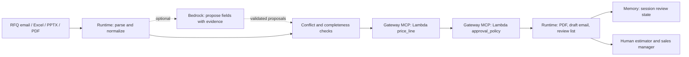

# AI Quotation Agent for a CNC Contract Manufacturer

An auditable, review-first RFQ workflow for the Axrail AI Application Engineer take-home. The sample data is fictional. The implementation parses email text, Excel, PowerPoint and a PDF drawing; merges duplicate parts; applies fixed pricing and approval rules; and writes a quotation PDF, buyer email draft and review list. It uses Amazon Bedrock AgentCore Runtime, Gateway (MCP) and Memory in AWS Singapore. The deterministic local scenarios and a live cloud invocation with the supplied four sample files have been verified. Optional Bedrock field extraction is off by default and has not been live-tested in this account.

## Local run

Python 3.11+ is required. Install the project and its test dependencies in a virtual environment as shown below.

For a quick preview on this machine, run `bash scripts/run_local_demo.sh` and open `output_all/quotation.pdf`. The script generates all three sample scenarios.

```bash
python3 -m venv .venv
source .venv/bin/activate
pip install -e '.[test]'
pytest -q

quote-rfq inputs/rfq_email.txt --context demo_context.json --output output_email
quote-rfq inputs/part_list.xlsx inputs/part_spec.pptx --context demo_context.json --output output_attachments
quote-rfq inputs/rfq_email.txt inputs/part_list.xlsx inputs/part_spec.pptx inputs/drawing_CVR-310_RevB.pdf --context demo_context.json --output output_all
```

For local Bedrock extraction, install the optional SDK with `pip install -e '.[bedrock]'` as well.

To opt into Bedrock extraction for the email/PDF text, set `BEDROCK_EXTRACTION_MODEL_ID` to a model or inference profile enabled for your account, configure AWS credentials with `bedrock:InvokeModel`, then add `--bedrock-extraction` to a `quote-rfq` command. This makes a billable model request. The flag is deliberately opt-in; the local demo script does not call a model.

Each output directory contains `quotation.pdf`, `quote.json`, `review.json` and `email_draft.txt`. `demo_context.json` supplies the same RFQ/customer/discount metadata to the attachment-only run; otherwise Excel and slides do not carry the buyer's discount request. The email-only and Excel-plus-PowerPoint runs produce the same priced lines and **MYR 74,684.00** total. Adding the PDF drawing reveals a quantity conflict for CVR-310 (1,000 vs 800), holds that line and produces **MYR 24,334.00** for the remaining priced lines. These are draft subtotals, not an accepted customer offer.

## Architecture and decisions



The agent is an explicit workflow. It can parse, reconcile, calculate, prepare documents and suggest review items. It cannot invent missing rates, approve a quote, apply the requested 15% discount or send an email. This keeps the price path deterministic and auditable. When enabled, a Bedrock model proposes part number, quantity, material and tolerance from email/PDF text. The program accepts a proposal only when its field has a matching source excerpt, passes type/range checks and reports confidence of at least 0.80; conflicting values go to the existing review path. Confidence is model-reported, not calibrated. The workflow records evidence and token usage, but sends no raw attachments to AgentCore Memory. Pricing and approvals never depend on model output alone.

| AgentCore capability | Use in this design |
| --- | --- |
| Runtime | Hosts the Python workflow via `agent_runtime.py`; isolated invocation and deployment. |
| Gateway | IAM-protected MCP entry to the two Lambda tools in `lambda_handler.py`. The cloud workflow calls both tools via Gateway, never directly. |
| Memory | Short-term RFQ session state: prior quote number, approval/review state and context for follow-up invocations. Raw attachments are not stored there. |
| Bedrock model (optional) | Converse API extracts candidate fields from searchable email/PDF text; the feature remains off unless `BEDROCK_EXTRACTION_MODEL_ID` is set. |
| Identity | IAM roles and SigV4 are used for Runtime-to-Gateway and Gateway-to-Lambda access. No third-party OAuth is required. |
| Observability | Runtime errors are visible in CloudWatch; quote number and part number are the correlation keys. Distributed traces have not been verified. |
| Code Interpreter | Not needed: fixed arithmetic in a tested tool is cheaper and reproducible. |
| Browser | Not needed: all inputs are supplied files; no website navigation is required. |

Compared with a LangGraph/LangChain supply-chain agent, I would retain explicit state transitions, structured input contracts, tool boundaries, review gates and regression tests. AgentCore Runtime replaces self-managed serving; Gateway replaces a custom MCP/tool gateway; Memory replaces ad hoc conversational session storage. Deterministic business data and approval authority stay in tools and human systems. This is a design comparison, not a claim of prior production deployment on AgentCore.

## Pricing, approval and provenance

`price_line` uses the supplied tables: AL6061 MYR 18/kg; SS304 MYR 22/kg; 3-axis MYR 2/min for tolerance ±0.05 mm or looser; 5-axis MYR 3.50/min for ±0.02 to under ±0.05 mm; setup MYR 250 per line; anodise MYR 1.50/part. Unit cost is `mass × material rate + cycle × machine rate + finish + setup/quantity`. A 25% **gross margin** assumption gives list price `unit cost / 0.75`. A 5% discount applies at 500–999 units and 8% at 1,000+ units. Unit price is rounded to MYR 0.01 before multiplying by quantity. Each priced line in `quote.json` carries the table rates, cost components, formula, discount and source references.

For BRK-100, unit cost is `0.40×18 + 6×2 + 1.50 + 250/500 = 21.20`. List price is MYR 28.27; after the standard 5% volume discount, unit price is MYR 26.86 and line total is MYR 13,430.00.

The supplied brief does not define a numeric large-quote threshold, so this implementation assumes **MYR 20,000**. A quote at or above it, a customer discount request above the standard 8% maximum, or any held line creates a pending manager review. The 15% request is recorded but never silently applied. All outputs are drafts until a person approves them. The email is a file, never automatically sent.

Review cases in the sample:

- SPC-050: no quantity; setup/quantity cannot be computed.
- HSG-400: Ti Gr5 has no material rate; ±0.005 mm has no standard machine rate. A specialist must also review feasibility.
- CVR-310 when the PDF is included: email and Excel say 1,000 pcs, drawing says 800 pcs. The conflicting line is held, not priced at either quantity.
- Customer asks for 15% off, beyond the standard schedule; sales manager decision required.

## AWS deployment plan

Use **ap-southeast-1 (Singapore)** for a Malaysian customer, subject to contract/data residency requirements and confirmation that the needed AgentCore features are available in the chosen region. Avoid AWS China regions. Provisioning and use can incur charges; inspect resources and pricing first.

1. Use a global AWS account with AgentCore access and check `aws sts get-caller-identity`. The AWS Free account plan does not offer AgentCore; a Paid plan can apply eligible new-user credits. Provisioning and invocations may incur charges.
2. Review and install the Python dependencies in `pyproject.toml` for **Linux ARM64 / Python 3.13** into an isolated target directory. Build the deployment artifact with `python scripts/build_runtime_zip.py /path/to/target`. The output `runtime-package.zip` contains code and dependencies only; sample RFQ files are passed in the invocation payload.
3. Upload the repository source and `runtime-package.zip` to AWS CloudShell. In the source directory, run `AWS_REGION=ap-southeast-1 python3 scripts/provision_aws.py`. This creates the pricing Lambda, IAM-protected MCP Gateway, and short-term Memory, then writes their nonsecret IDs to `.env.aws.example`.
4. Run `AWS_REGION=ap-southeast-1 python3 scripts/deploy_runtime.py /path/to/runtime-package.zip`. This creates or updates a private S3 artifact bucket, a narrowly scoped execution role, and a Python 3.13 CodeZip Runtime with a five-minute idle timeout. By default, the Runtime role may call only this Gateway and Memory and read its deployment ZIP. Check the reported Runtime status and invoke with the payload shape below. Verify both Gateway tools, Memory events, and CloudWatch logs before claiming a successful cloud run.
5. To enable the optional extraction step, first choose a model or inference profile supported in the Bedrock source region and available to the account. Set its exact ID in `.env.aws.example` as `BEDROCK_EXTRACTION_MODEL_ID=...`, rebuild the Runtime ZIP, then run the deployment command again. The deploy script adds `bedrock:InvokeModel` permission scoped to the foundation model ARN or to the selected inference profile and its destination model ARNs. Cross-Region profiles can route outside Singapore; check the model's current regional routing and data residency requirements before using customer documents. Invocation usage is billable; the disabled default makes no model call.

Runtime payload shape:

```json
{
  "actor_id": "customer_example",
  "session_id": "RFQ_2026_118",
  "context": {"rfq_no": "RFQ-2026-118", "requested_discount_pct": 15},
  "attachments": [{"name": "rfq_email.txt", "data_b64": "<base64 file bytes>"}]
}
```

The Runtime response includes the quote JSON, PDF bytes as base64, and previous Memory session state. It fails closed when Gateway/Memory configuration or credentials are missing. For a live demo, generate a payload and invoke the ARN shown in the AgentCore console:

```bash
python3 scripts/make_payload.py inputs/rfq_email.txt inputs/part_list.xlsx inputs/part_spec.pptx inputs/drawing_CVR-310_RevB.pdf > payload.json
python3 scripts/invoke_runtime.py 'arn:aws:bedrock-agentcore:ap-southeast-1:ACCOUNT:runtime/RUNTIME_ID' payload.json
```

The second command saves `quote.json`, `quotation.pdf` and `previous_session_state.json` in `output_cloud`. The adapter uses stateless MCP protocol `2026-07-28` and SigV4; the Gateway must list that version under `supportedVersions`. Confirm tool names returned by `tools/list`; override `AGENTCORE_PRICE_TOOL` and `AGENTCORE_APPROVAL_TOOL` if Gateway uses different prefixes.

## Cost per quote

The default path makes no model invocation. When enabled, each text email or searchable PDF causes one Bedrock Converse request; its input/output tokens are recorded in `extraction_audit`. Total cloud cost is Runtime compute + Gateway requests + Lambda invocations/duration + Memory events/storage + logs + any Bedrock input/output tokens, plus deployment storage. Check current model pricing and routing before enabling, keep Memory events small, and avoid always-on compute. No precise per-quote estimate is asserted without a live usage measurement.

## Known limits

- The live Runtime invocation returned a quotation and the next invocation retrieved the saved session state from Memory. Gateway protocol support includes MCP `2026-07-28`; the original `2025-06-18` request failed because that version was not enabled.
- Optional Bedrock extraction is implemented but has not been enabled or verified in the live Runtime. Model access, model choice, regional routing and billable invocation must be configured first.
- The parsers target text PDFs and table-like Excel/PowerPoint plus the provided email layout. Scanned drawings require OCR; arbitrary layouts need a constrained extraction step and human checks.
- PDF output is a draft quotation, not an approval workflow UI. Approval status is pending; no human sign-off is simulated.
- Tax, freight, currency conversion, shipping and feasibility are excluded and stated as assumptions.
- The buyer address and all sample files are fictional and included for demonstration only.

## References

- [AgentCore Runtime quickstart](https://github.com/aws/bedrock-agentcore-starter-toolkit/blob/main/documentation/docs/user-guide/runtime/quickstart.md)
- [Gateway Lambda target and schema](https://docs.aws.amazon.com/bedrock-agentcore/latest/devguide/gateway-add-target-api-target-config.html)
- [Gateway IAM authorization](https://docs.aws.amazon.com/bedrock-agentcore/latest/devguide/gateway-create-api.html)
- [AgentCore Memory SDK](https://docs.aws.amazon.com/bedrock-agentcore/latest/devguide/aws-sdk-memory.html)
- [Bedrock Converse API](https://docs.aws.amazon.com/bedrock/latest/userguide/conversation-inference.html)
- [Bedrock model regional availability](https://docs.aws.amazon.com/bedrock/latest/userguide/models-region-compatibility.html)
- [Supported AWS Regions](https://docs.aws.amazon.com/bedrock-agentcore/latest/devguide/agentcore-regions.html)
